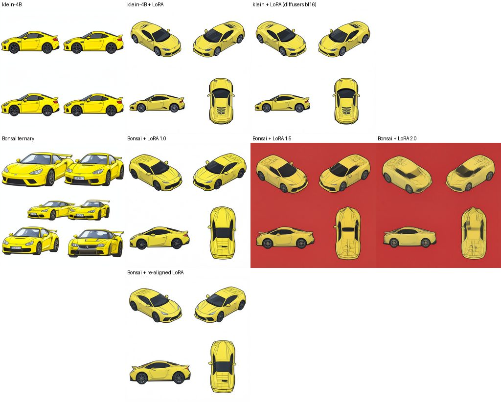

# bitnet-vision

Ternary ("1.58-bit") Vision Transformers in PyTorch. Every weight in the transformer layers is -1, 0 or
+1, following Microsoft's BitNet b1.58 recipe, with optional BitNet v2 Hadamard layers for 4-bit
activations. The repo covers the whole path: layers, a ViT model, CIFAR-10 training with distillation, and
export to packed 2-bit weights that make checkpoints 8 to 14 times smaller.

## Words used here

* **Ternary weights**: each weight is stored as -1, 0 or +1 (about 1.58 bits of information), plus one
  floating-point scale per weight matrix. That is what makes the model small.
* **Absmean / absmax scale**: how a block of numbers is shrunk onto the small integer grid. Weights are
  divided by their average size (absmean); activations by their largest value per token (absmax).
* **Per-token**: each image patch (token) gets its own activation scale, so one loud patch does not
  drown out the others.
* **Straight-through estimator (STE)**: rounding has no useful slope, so during training the gradient is
  passed through the rounding step as if it were not there. Getting this exactly right is what the old
  branches of this repo failed at (see [docs/AUDIT.md](docs/AUDIT.md)).
* **RMSNorm**: rescales each token to a standard size. BitNet puts one inside every quantized layer.
* **Hadamard rotation**: a fixed, lossless mixing of the channels. It spreads a few very large values
  across all channels, so they can be stored with fewer bits (BitNet v2's trick for 4-bit activations).
* **Distillation**: the ternary "student" learns to copy the predictions of a full-precision "teacher".

## What is in here

| Piece | What it does |
|---|---|
| `BitLinear` | Drop-in replacement for `nn.Linear` with ternary weights and 8-bit activations. Matches Microsoft's reference code exactly, in outputs and gradients. |
| `HBitLinear` | BitNet v2 layer: rotates its input with an exact Hadamard matrix (with fixed random sign flips) before quantizing. Works at every standard ViT width (192, 384, 768, 1536, 3072, ...). |
| `BitViT` | A Vision Transformer whose qkv, projection and MLP layers are ternary. The patch embedding, position embeddings, norms and classifier head stay in full precision: quantizing those costs a lot of accuracy for very little size. |
| Training | CIFAR-10 loader, BitNet's two-stage schedule and other schedules, distillation, "full precision first, then ternary" switching, BitNet v2's late switch to 4-bit activations, bf16 autocast, safe resumable checkpoints. |
| Export | `convert_for_inference` stores 4 weights per byte and runs int8 activations through an integer matmul. |
| LoRA | Small full-precision adapters on any ternary layer or `nn.Linear`, trained with the base model frozen, saved and loaded in PEFT's file format, kept through export. |
| Ternary FLUX.2 | PrismML's ternary FLUX.2 klein (Bonsai Image 4B) kept at 2 bits per weight, with existing FLUX.2 klein LoRAs on top, and a script that measures and re-trains how well they transfer (experimental). |

Why each design choice was made, with the papers behind it: [docs/RESEARCH.md](docs/RESEARCH.md).
What was wrong with the earlier attempts in this repo: [docs/AUDIT.md](docs/AUDIT.md).

## Install

```bash
pip install torch          # any version from 2.2, CPU or CUDA
pip install -e ".[dev]"    # add ,lora for safetensors adapter files: ".[dev,lora]"; ,flux for FLUX.2
pytest -q                  # about a minute on a laptop CPU; add -m "not slow" to skip training checks
```

## Quick start

```python
import torch
from bitnet_vision import BitLinear, create_model, convert_for_inference

# A ternary layer, used like nn.Linear
layer = BitLinear(768, 3072)
y = layer(torch.randn(8, 197, 768))

# A ternary ViT for 32x32 images, and its full-precision twin (same parameter names)
model = create_model("bitvit_cifar_tiny")
teacher = create_model("bitvit_cifar_tiny", quantize=False)
logits = model(torch.randn(4, 3, 32, 32))

# After training: pack the weights for inference
packed = convert_for_inference(model)
```

Presets: `bitvit_cifar_tiny` (1.8M parameters), `bitvit_cifar_small` (7.2M), and the ImageNet-sized
`bitvit_tiny_patch16_224`, `bitvit_small_patch16_224`, `bitvit_base_patch16_224`.

Model options (keyword arguments to `create_model`, or `scripts/train.py` flags):

| Option | Default | Meaning |
|---|---|---|
| `quantize` | True | False gives the full-precision twin (`--fp`) |
| `hadamard` | False | BitNet v2 layers for the attention output and MLP down projections (`--hadamard`) |
| `hadamard_random_signs` | True | sign flips before the rotation; turn off for BitNet v2's plain rotation (`--no-hadamard-signs`) |
| `act_bits`, `hadamard_act_bits` | 8, 8 | activation bits; 4 uses BitNet v2's absmean quantizer |
| `weight_granularity` | "tensor" | "channel" gives one weight scale per output row |
| `block_norm` | True | the usual ViT LayerNorms in each block, on top of the RMSNorm inside each layer (`--no-block-norm`) |
| `pool` | "cls" | "mean" or "seqpool" (learned attention pooling) |
| `deadzone_lambda` | 0 | Tequila's fix for weights stuck at 0; the paper uses 1e-3 |
| `layer_scale_init`, `drop_path_rate`, `mlp_act` | off, 0, "gelu" | LayerScale, stochastic depth, squared-ReLU MLP |

## Training on CIFAR-10

CIFAR-10 is downloaded automatically (checksum verified) into `--data-dir`.

```bash
# 1) full-precision baseline, also the teacher
python scripts/train.py --fp --schedule cosine --wd 0.05 --epochs 15 --out runs/fp

# 2) ternary from scratch with BitNet's two-stage schedule
python scripts/train.py --schedule bitnet --lr 1e-3 --epochs 15 --out runs/ternary_scratch

# 3) ternary, started from the baseline and distilled from it
python scripts/train.py --init runs/fp/model.pt --teacher runs/fp/model.pt --schedule restart \
    --lr 2e-4 --wd 0.05 --stage2-wd 0.01 --warmup-epochs 0.5 --epochs 10 --out runs/ternary_kd

# evaluate the packed 2-bit checkpoint, and benchmark the trained model
python scripts/eval.py runs/ternary_kd/packed.pt
python scripts/bench.py --checkpoint runs/ternary_kd/model.pt
```

`scripts/cifar_experiments.sh` runs all three in sequence, plus a fourth full-precision run with the
same schedule as run 2, so the two differ only in quantization. Every run writes `metrics.json` (per-epoch
accuracy and loss), `model.pt` and `summary.json`; ternary runs also record the share of weights at -1, 0
and +1 and how many changed each epoch, and write the packed `packed.pt`. Interrupted runs continue with
`--resume` and the original command line; the model is rebuilt from the checkpoint, and changed training
settings are refused rather than silently bending the schedule.

Schedules (`--schedule`): `bitnet` (Microsoft's recipe: learning rate times 2/3 and weight decay off at the
midpoint), `bitnet_cosine`, `restart` (a short low learning-rate phase at the end, from FTerViT), `wsd`
(hold the learning rate, then cool down over the last 10%), `cosine` and `linear`.

Things worth knowing:

* **The share of zero weights is the health check.** Healthy runs keep roughly 25 to 40% of the ternary
  weights at 0, and training logs a warning outside 10 to 70%. Drifting toward 100% means gradient is
  leaking into the quantization scales (exactly how one of the old branches failed).
* **Do not copy learning rates from language models.** Small vision models do best around 1e-3 from
  scratch and 1e-4 to 2e-4 when starting from full-precision weights.
* **Starting from a full-precision model helps most.** Published results put it at about 5 points of
  ImageNet accuracy for small ViTs. `--fp-fraction 0.2` does the same inside a single run.
* **Distillation** defaults to 90% teacher-matching (KL) and 10% ordinary cross-entropy, which helps when
  the teacher is a small CPU-trained model. `--distill-alpha 1.0` is FTerViT's pure-KL setting.
* **BitNet v2 4-bit activations:** train with `--hadamard` and add `--final-act-bits 4`. Like BitNet v2,
  this trains with 8-bit activations and switches every layer to 4 bits for the last 5% of steps
  (`--final-act-bits-scope rotated` switches only the Hadamard layers).
* `torch.compile` works, but on PyTorch older than 2.5 a `--quant-ramp-epochs` ramp makes it recompile
  every step; compile only after the ramp or use a newer PyTorch.

## Results on CIFAR-10

One run of each line in `scripts/cifar_experiments.sh` with `bitvit_cifar_tiny` (1.8M parameters), on 4
CPU threads with no GPU, at commit 7ef581c (the training code has not changed since). Per-epoch numbers
are in [docs/cifar10_results.json](docs/cifar10_results.json).

| Run | Epochs | Test accuracy | Packed 2-bit model | Weights at 0 | Saved size |
|---|---|---|---|---|---|
| Full precision, cosine schedule | 15 | 63.4% |  |  | 7.2 MB |
| Full precision, BitNet schedule | 15 | 65.1% |  |  | 7.2 MB |
| Ternary, from scratch, BitNet schedule | 15 | 67.1% | 67.1% | 32% | 0.61 MB |
| Ternary, from the cosine full-precision model + distillation | 10 | 64.0% | 64.0% | 33% | 0.61 MB |

What this shows:

* **The 2-bit export is faithful.** The packed model scores the same as the model it came from (within
  0.02 points) and is 11.8 times smaller.
* **Training is healthy.** Each of the 24 ternary layers keeps 31 to 37% of its weights at 0 (no layer
  collapsed toward all zeros), and the accuracy curves rise steadily.
* **Ternary kept up with full precision on this small budget.** With the identical schedule, the ternary
  model was ahead at every epoch from epoch 3 on and finished 2.0 points higher. It also reached a lower
  training loss, so the lead comes from learning faster, not only from doing better on new images.
* **The schedule matters too.** The same full-precision model scored 1.7 points higher with BitNet's
  two-stage schedule than with a cosine schedule.

What it does not show:

* **These are short runs.** 15 epochs on a CPU, and every model was still improving at the end. In the
  runs trained from scratch, accuracy on the training images never rose above accuracy on the test images
  (training sees randomly cropped and flipped images), so all of them were far from finished. CCT reports
  about 91% for ViTs of 3 to 4M parameters trained for 300 epochs.
* **One seed each.** Gaps of a point or two between runs can come from the random seed alone.
* **"Ternary beats full precision" is not the general rule.** Published results have ternary ViTs a few
  points behind full precision (ViT-1.58b on CIFAR-10: 72.3% vs 76.3%), so do not expect this lead to
  hold with longer training or bigger models.
* **Distillation was limited by its teacher.** The distilled model started from the 63.4% cosine
  baseline, which was also its teacher, and ended 0.5 points above it. A stronger teacher (longer
  training, or a pretrained model) is what would make this route pay off.

## LoRA adapters

A LoRA adapter (low-rank adaptation, Hu et al., arXiv 2106.09685) teaches a trained model something new
without changing it. Next to a layer it adds two small matrices, A (r x in) and B (out x r), and the layer
then computes `layer(x) + strength * (alpha / r) * B(A(x))`. Only A and B are trained, so the adapter is a
small file that can be added, mixed with others, switched off or removed at any time. B starts at zero, so
a new adapter changes nothing until it is trained.

Every ternary layer (training, packed and Apple versions) and every plain `nn.Linear`, such as the
classifier head, can carry adapters. They stay in full precision next to the ternary weights:

* **They are too small to be worth quantizing.** At rank 8 an adapter adds `8 * (in + out)` values to a
  layer that holds `in * out` ternary weights. QLoRA (Dettmers et al., arXiv 2305.14314) does the same:
  16-bit adapters on a frozen 4-bit model.
* **Small corrections need fine steps.** Rounding A and B to -1, 0 and +1 would wipe out the small
  adjustments an adapter learns.
* **They see the layer's input as it arrives,** before BitLinear's own RMSNorm and Hadamard rotation, and
  are added after the bias. That is exactly what a LoRA trained on an ordinary `nn.Linear` expects, and the
  packed 2-bit model runs the very same branch, so exporting changes nothing.

Cost: `r * (in + out)` extra multiply-adds per token in each layer with an adapter. Rank 8 on qkv, proj,
fc1 and fc2 adds 6% to the work of the ternary layers in `bitvit_cifar_tiny` and 1.4% in
`bitvit_base_patch16_224`. The adapter files are 0.45 MB and 4.7 MB (float32), next to packed models of
0.66 MB and 28 MB.

Train one on top of a trained model (pass the same model flags as that model's run; the base stays frozen,
and `--lora-train-head` also trains the classifier head):

```bash
python scripts/train.py --init runs/ternary_scratch/model.pt --lora-r 8 --lr 1e-3 --schedule cosine \
    --epochs 5 --out runs/lora
python scripts/eval.py runs/ternary_scratch/model.pt --lora runs/lora/lora
```

`runs/lora/lora` holds the adapter in PEFT's format: `adapter_config.json` and `adapter_model.safetensors`
(`adapter_model.bin` without the safetensors package). `model.pt` and `packed.pt` hold the whole model,
adapter included. In Python:

```python
from bitnet_vision import add_lora, load_lora, mark_only_lora_trainable, save_lora, set_lora_strength
from bitnet_vision.checkpoint import load_model, load_packed

model = load_model("runs/ternary_scratch/model.pt")
add_lora(model, r=8, alpha=16)          # qkv, proj, fc1 and fc2 of every block
mark_only_lora_trainable(model)         # extra=("head",) trains the head too
...                                     # any training loop, or bitnet_vision.training.train
save_lora(model, "my_adapter")

# Later, on the training model or the packed one; several adapters at once, each with its own strength
model = load_packed("runs/ternary_scratch/packed.pt")
load_lora(model, "my_adapter", name="style", strength=0.8)
load_lora(model, "other_adapter", name="detail")
set_lora_strength(model, 0.3, "detail")  # disable_lora, enable_lora and delete_lora work the same way
```

Things worth knowing:

* **Existing LoRAs.** `load_lora` reads PEFT's files and plain state dicts, and checks every shape before
  it changes anything. Adapters whose module names and shapes match this model's (`blocks.3.attn.qkv`,
  `head`, ...: timm's ViT names) load directly; adapters made for other models need their keys renamed
  first. FLUX.2 klein LoRAs for image generation have their own loader (next section).
* **Merging.** `merge_lora_into_weights` folds an adapter into the weights only where that is exact: plain
  `nn.Linear` layers, and ternary layers built without the inner norm (`input_norm=False`). BitViT's
  ternary layers normalize their input inside the layer while the adapter does not, so no change of their
  weights reproduces it, and a merged ternary layer gets new ternary codes anyway. Keep adapters as side
  branches; that is exact and cheap.
* **Checkpoints** (`save_model`, `save_packed` and the training loop's `last.pt`) store the adapters and
  load them back. Older checkpoints load as before.
* **`torch.compile`:** add or load adapters before compiling. PyTorch 2.4 and newer notice later changes
  of strength or on/off; PyTorch 2.2 does not (call `torch._dynamo.reset()` after such changes).

## Existing image LoRAs (ternary FLUX.2 klein)

Experimental. The only ternary text-to-image model released at scale is PrismML's Bonsai Image 4B: FLUX.2
[klein] 4B with the 100 matmul layers of its 25 transformer blocks ternary (-s, 0 or +s, one scale s per 128
weights along the input axis). Unlike BitNet it is weight-only: activations stay 16-bit and there is no norm
inside the layers. Embedders, modulation layers, `norm_out` and `proj_out` stay 16-bit. Bonsai keeps klein's
layer names and shapes, so the LoRAs people trained for FLUX.2 klein 4B (about 180 on Hugging Face and 420 on
Civitai on 2026-10-12; klein-base 4B LoRAs fit too) attach to it unchanged. `bitnet_vision.generators` loads
Bonsai with those 100 layers kept at 2 bits in memory and runs such LoRAs on top as full-precision side
branches. `scripts/flux2_lora.py` makes images, measures how much of a LoRA's effect survives on the ternary
base, and can re-train a LoRA to fit that base better.

### What works

* **Loading Bonsai.** `load_bonsai_transformer()` reads either Bonsai repo (by default the MLX pack, a 1.43 GB
  download; or the 7.75 GB bfloat16 one) or a local copy, and returns diffusers' `Flux2Transformer2DModel`
  whose 100 ternary layers are `PackedTernaryLinear`. It builds the model without weights and reads one
  tensor at a time, so the dense weights never exist: the packed transformer holds 1.37 GB (0.92 GB of 2-bit
  codes, 0.06 GB of scales, 0.39 GB of 16-bit layers) against 7.75 GB dense. It checks that the weights
  really are ternary and refuses them otherwise. Checked on the real files: both layouts load to identical
  tensors, and the packed transformer's output equals diffusers' dense bfloat16 model bit for bit.
* **The layer.** `PackedTernaryLinear` stores 4 codes per byte plus one scale per group. Each call rebuilds
  the dense weight in the input's dtype (exact, since every weight is a code times a scale) and calls
  `F.linear`, then drops it. `cache_dense=True` keeps it (dense speed, dense memory).
* **LoRA files.** `load_flux2_lora` takes a file, a folder, a Hugging Face repo id or a state dict, in every
  FLUX.2 format diffusers 0.41 reads: PEFT, diffusers, ai-toolkit, BFL names and kohya. The keys go through
  diffusers' own `Flux2KleinPipeline.lora_state_dict`, so names, the split of fused qkv LoRAs into q, k and
  v, and the scale (kohya's alpha / rank, the `lora_adapter_metadata` header with rsLoRA and rank or alpha
  patterns, otherwise 1) are what `pipe.load_lora_weights` uses. Fused single-block layers
  (`to_qkv_mlp_proj`) stay one layer with one LoRA, as in diffusers. Every module of fal's spritesheet LoRA
  computes exactly what diffusers' LoRA layer computes (checked on the real file). Several LoRAs load side by
  side under different names, each with its own strength (`set_lora_strength`).
* **Nothing is dropped silently.** Text-encoder parts are skipped with a warning and listed in the returned
  summary. Everything else that cannot be attached (DoRA, LoHa, LoKr and other LyCORIS types, LoRA biases,
  modules diffusers' converter does not map, wrong shapes) is refused with the reason before the model
  changes. diffusers itself drops DoRA's `dora_scale` and unmapped kohya modules with only a log message.
* **Why side branches.** Merging a LoRA into ternary weights means rounding again, and a LoRA's change is far
  smaller than half a rounding step: on five slices of Bonsai, re-rounding with the spritesheet LoRA merged
  in changed 0 codes. `merge_lora_into_weights` refuses packed layers.
* **Tested here** on a tiny FLUX.2 transformer: both Bonsai file layouts, every LoRA format against diffusers'
  own loading (float32, exact up to summation order), and the script's sampler against `Flux2KleinPipeline`
  bit for bit. Three more tests run only on an Apple GPU (unpacking there, loading straight onto `mps`, LoRA
  on the GPU model).

```python
import torch
from diffusers import Flux2KleinPipeline
from bitnet_vision.generators import BONSAI_UNPACKED, load_bonsai_transformer, load_flux2_lora

transformer = load_bonsai_transformer()   # prism-ml/bonsai-image-ternary-4B-mlx-2bit
print(load_flux2_lora(transformer, "Sawata97/flux2_4b_koni_animestyle", name="anime", strength=1.0))
# text encoder, tokenizer, VAE and scheduler; the 7.75 GB transformer folder of that repo is not downloaded
pipe = Flux2KleinPipeline.from_pretrained(BONSAI_UNPACKED, transformer=transformer, torch_dtype=torch.bfloat16)
pipe.to("mps")
image = pipe("anime_style, a red fox in a snowy forest", num_inference_steps=4, guidance_scale=1.0,
             generator=torch.Generator("cpu").manual_seed(0)).images[0]
```

### On the Mac

macOS 14 or newer (bfloat16 on the GPU) and PyTorch 2.14 or newer:

```bash
python3 -m venv .venv && source .venv/bin/activate
pip install -U "torch>=2.14" && pip install -e ".[flux,dev]"
pytest tests/test_weight_only.py tests/test_flux2.py tests/test_flux2_scripts.py   # includes the GPU-only checks
python scripts/flux2_lora.py generate --tiny     # the whole path on a tiny random model: seconds, no download

LORA=Sawata97/flux2_4b_koni_animestyle           # a text-to-image style LoRA for klein 4B, trigger anime_style
python scripts/flux2_lora.py generate --lora $LORA --prompt "anime_style, a red fox in a snowy forest" --seed 0 1
python scripts/flux2_lora.py compare --lora $LORA --prompt "anime_style, a red fox in a snowy forest" \
    --prompt "anime_style, a lighthouse on a rocky coast" --seed 0 1
python scripts/flux2_lora.py realign --lora $LORA --out flux2_results/realigned-anime
python scripts/flux2_lora.py realign --lora $LORA --match effect --out flux2_results/realigned-anime-effect
python scripts/flux2_lora.py compare --lora $LORA --realigned flux2_results/realigned-anime \
    --prompt "anime_style, a hot air balloon over green hills" --seed 0
```

Results go to `flux2_results/` (images, a labeled `grid.png`, and a JSON file with every setting, the
metrics, timings and memory readings). If PyTorch reports an operation missing on MPS, rerun with
`PYTORCH_ENABLE_MPS_FALLBACK=1`. Downloads, about 17.6 GB in all: the Bonsai pack (1.43 GB), the text
encoder, tokenizer and VAE (8.2 GB), klein 4B's transformer (7.75 GB, only for `compare` and `realign`) and
the LoRA. Only one transformer is in memory at a time, and the text encoder (8 GB, the largest part) is freed
once the prompts are encoded, so 96 GB is far more than any command needs. A 16 GB Mac (an 11.8 GB GPU
working set) also runs them, with little room: the size drops to 512 x 512, other apps should be closed, and
`--text-encoder-device cpu` encodes the prompts on the CPU if loading the text encoder runs out of memory.

The three commands (`--device` and `--dtype` pick other devices and dtypes; `--tiny` runs any of them on a
tiny random pipeline built on the spot, which is what the tests do):

* **generate**: Bonsai, packed, with any number of `--lora SOURCE[:STRENGTH]`. `SOURCE` is a file, a folder,
  a repo id, or `owner/repo/file.safetensors` for a repo holding several files. 4 steps and guidance 1.0 as
  the model cards say; 1024 x 1024 on a GPU with 24 GB or more, 512 x 512 on smaller ones and the CPU. The
  loop repeats `Flux2KleinPipeline`'s own, so for the same noise the image is exactly the pipeline's. The text
  encoder and VAE come from Bonsai's unpacked repo; they are byte-identical to klein 4B's (same SHA-256), so
  one encoding serves both bases.
* **compare**: the same prompts, seeds and noise through (a) klein 4B, (b) klein 4B + LoRA, (c) Bonsai,
  (d) Bonsai + LoRA, and with `--realigned` (e) Bonsai + the re-aligned LoRA. With D = (with LoRA) minus
  (without), on the same base: `first_step_cos` and `first_step_norm` compare D of the transformer's output
  at the first step, where both bases get identical inputs (the noise), so they isolate the LoRA's effect
  (cosine of D on Bonsai with D on klein, and the ratio of their sizes). `retention_cos` and `retention_norm`
  do the same for the final latents, which also carry the drift between the two bases' trajectories, so they
  read lower even when the images look alike. `psnr_d_vs_b` compares image (d) with (b); `psnr_c_vs_a` gives
  the gap between the bases without any LoRA, for scale.
* **realign**: data-free distillation, as EfficientDM (arXiv 2310.03270) does for quantized diffusion models.
  Teacher: klein 4B + the LoRA, frozen. Student: packed Bonsai + the same LoRA, of which only A and B train.
  The teacher samples 32 trajectories (16 built-in prompts with the LoRA's trigger words, 2 seeds each, 512
  x 512) and the student learns its outputs at exactly the same inputs. `--match output` (default,
  EfficientDM's loss) matches the outputs, so the LoRA also learns to pull Bonsai toward klein: judge it by
  `psnr_e_vs_b`. `--match effect` matches the LoRA's effect (with minus without), so the LoRA stays a pure
  add-on (strength 0 is plain Bonsai) and the retention numbers are what should rise. AdamW, lr 1e-4, 300
  steps, gradient checkpointing, the model's own dtype. 4 held-out prompts with new seeds are scored every
  100 steps. It saves `pytorch_lora_weights.safetensors` in diffusers' format (rank and alpha in its
  metadata; `pipe.load_lora_weights` and `load_flux2_lora` both read it, with the same result) and the same
  adapter in this repo's PEFT format under `peft/`.

Three text-to-image LoRAs load as they are (checked on the files): `Sawata97/flux2_4b_koni_animestyle`
(ai-toolkit format, 100 modules, rank 64, trigger `anime_style`), `Limbicnation/pixel-art-lora` (diffusers
format with rsLoRA metadata, 86 modules, rank 64) and `adirik/pixel-art-lora-flux.2-klein-4B` (trained on
klein-base 4B, 100 modules, rank 128, trigger `PXART4`). fal's spritesheet LoRA is an image-editing LoRA, so
the text-to-image commands show little of it; its repo holds two different LoRAs, so name the file:
`--lora fal/flux-2-klein-4b-spritesheet-lora/flux-spritesheet-lora.safetensors`.

### What a real run measured

Nothing has run on a Mac yet. One real run on a 4-thread Linux CPU, with standalone scripts that call
`load_bonsai_transformer`, `load_flux2_lora` and diffusers 0.41's `Flux2KleinPipeline` (before
`scripts/flux2_lora.py` existed). Setup: bfloat16 models, 4 steps, guidance 1.0, the prompt padded to 512
text tokens. Bonsai packed from the MLX pack; klein 4B dense. The LoRA, the only one tested, was
`fal/flux-2-klein-4b-spritesheet-lora` (`flux-spritesheet-lora.safetensors`, rank 16) at strength 1.0, in
float32 on both bases. Prompts: "2x2 sprite sheet of a yellow sports car", "2x2 sprite sheet of a green army
tank" and "a photo of a cat sitting on a wooden table, soft window light"; seeds 11 and 12; 512 x 512; the
same noise for both bases.

* **Images.** With the LoRA, both bases drew the LoRA's 2 x 2 sheet in all 4 sprite runs (two isometric views
  on top, a side view and a top-down view below, flat cartoon style, white background). Without it, klein
  drew 4 identical side views and Bonsai 4 to 6 front or side views: the bases differ a lot on their own (the
  final latents by 104% in relative norm, on average). On the cat prompt the LoRA made a small change of the
  same kind on both bases (cat more centered and frontal, warmer), with no sprite sheet leaking in.
* **How much of the LoRA's effect survives** (means over the 6 prompt and seed pairs):

  | D = with LoRA minus without, on the same base | cos(D on Bonsai, D on klein) | size ratio |
  |---|---|---|
  | Transformer output at the first step (identical inputs) | 0.45 (0.26 to 0.66) | 0.59 |
  | Transformer output at klein + LoRA's own states (24 held-out states, 256 x 256) | 0.45 | 0.68 |
  | Final latents | 0.28 (0.06 to 0.51) | 0.94 |
  | Decoded pixels | 0.33 | 1.02 |
  | Pixels averaged down to 16 x 16 | 0.51 (sprite prompts only: 0.58) | |

  For comparison, the same LoRA through diffusers' own loader (bfloat16 adapter) against this one (float32),
  both on klein, gives a final-latent cosine of 0.989 to 0.999: the low values above are real, not rounding.
  So the LoRA keeps its direction only partly (cosine about 0.45 at identical inputs) and about 60 to 70% of
  its size. Yet in all 4 sprite runs it moved Bonsai's image toward klein + LoRA's: at 16 x 16, Bonsai + LoRA
  was closer to klein + LoRA (relative distance 0.10, 0.17, 0.10, 0.15) than Bonsai was to klein without it
  (0.27, 0.35, 0.14, 0.20). The cat runs did not move closer.
* **Strength above 1** makes the effect larger, not better aimed: at strength 1, 1.5 and 2 the first-step size
  ratio was 0.59, 0.74 and 0.85 and the cosine 0.45, 0.43 and 0.37. At 1.5 and 2 the background of all 4
  Bonsai sprite sheets turned red, the color of the LoRA's own editing example (klein at 1.0 stays white in
  text-to-image; klein at 1.5 was not run).
* **Image editing** (the LoRA's own use, its card's jet fighter as input, one sample): klein + LoRA gave a sheet
  close to fal's example; Bonsai + LoRA gave a 2 x 2 sheet of four views on a salmon background with a less
  faithful jet (final-latent cosine 0.28, decoded pixels 0.80, at 16 x 16 0.91).
* **Re-alignment did not help at a small budget.** Matching the LoRA's effect (as `--match effect` does) on 64
  teacher states (8 other prompts, 2 other seeds, 4 steps, 256 x 256), 48 Adam steps at lr 1e-4, one state per
  step: on held-out prompts and seeds the cosine went from 0.45 to 0.42 and the size ratio from 0.68 to 0.57
  (on the training states the cosine rose from 0.40 to 0.51), and in full generation at 512 the final-latent
  cosine went from 0.28 to 0.26. Whether a much longer run helps (EfficientDM trains 16,000 iterations) is
  untested.
* **Time per sampling step** at 512 x 512 on that CPU: packed Bonsai 10.6 to 12.7 s without a LoRA and 14.5 to
  16.3 s with it; dense klein 6.7 to 8.9 s, 11.0 to 12.1 s with this LoRA branch and about 9.2 to 10.2 s with
  diffusers' bfloat16 LoRA. **Memory:** loading the MLX pack took 19 s and 1.51 GB (3.22 GB resident with the
  memory-mapped file); Bonsai generating at 512 with the LoRA used 2.70 GB (3.31 GB resident), re-alignment
  3.49 GB; dense klein 9.31 GB resident (mostly its memory-mapped 7.75 GB file); the text encoder 8.99 GB
  resident.

The sample is small: one LoRA, 3 prompts, 2 seeds, no CLIP or FID score.



*"2x2 sprite sheet of a yellow sports car", seed 11, 512 x 512, from the run above. Top: klein 4B, klein 4B
with the LoRA (this repo's loader, then diffusers' own). Middle: ternary Bonsai, then with the LoRA at
strength 1.0, 1.5 and 2.0. Bottom: Bonsai with the briefly re-aligned LoRA.*

### Limits

* **Ternary saves memory, not time, on an M2 Max.** Its GPU has no faster low-bit arithmetic, and the packed
  layers rebuild their dense weights on every call: on the CPU above a packed step was 40 to 60% slower than
  dense klein. Mac timings are not measured yet. `cache_dense=True` (`--cache-dense`) gives the speed back
  along with the memory.
* **How well a LoRA transfers varies,** and the one measured kept only about half its effect. Bonsai's
  weights differ from klein 4B's by 54 to 57% in relative norm, while a LoRA's own change is 2 to 3%. Run
  `compare` on your LoRA before relying on it; LoRAs for klein 9B or FLUX.2 dev do not fit at all.
* **Only plain LoRA.** DoRA, LoKr, LoHa and the other LyCORIS types are refused, as are ai-toolkit files with
  `lora_down` / `lora_up` keys under `diffusion_model.` (diffusers cannot load those either).
* **Text-encoder parts of a LoRA are skipped** (with a warning): only the transformer takes adapters.
* **Adapters are float32** by default, so float32 files load unrounded; diffusers stores them in the model's
  dtype. That rounding matters: in diffusers alone, switching the adapter from float32 to bfloat16 moves the
  model's output by 10.6% of the LoRA's effect. `adapter_dtype=None` gives diffusers' behavior. diffusers'
  `joint_attention_kwargs={"scale": ...}` does not reach these adapters: use `set_lora_strength`.
* **Packed layers have no `.weight`.** The normal forward pass does not need it, but code that reads it (qkv
  fusion, some offloading hooks) fails on those 100 layers.
* **The script makes images from text only.** Editing LoRAs need an input image: use the pipeline directly
  with `image=`.

### Licenses

Bonsai Image 4B is Apache-2.0 (PrismML; its notice names FLUX.2 [klein] 4B and Qwen3-4B as sources). FLUX.2
[klein] 4B (Black Forest Labs) and the Qwen3-4B text encoder are Apache-2.0 too; other FLUX.2 models have their
own terms. Every LoRA has its own license: the four named here declare Apache-2.0 on their model cards
(checked 2026-10-12), but check each one before you use or share its results, and note that many LoRAs on
Hugging Face and Civitai depict real people or adult content.

## Memory and speed, honestly

During training `BitLinear` keeps full-precision weights and only simulates quantization, so it is a bit
slower than `nn.Linear` and no smaller. The savings come from `convert_for_inference`:

| Preset | Full precision | Packed | Smaller by |
|---|---|---|---|
| `bitvit_cifar_tiny` | 7.2 MB | 0.61 MB | 11.8x |
| `bitvit_cifar_small` | 28.7 MB | 2.1 MB | 13.6x |
| `bitvit_tiny_patch16_224` | 22.9 MB | 3.0 MB | 7.6x |
| `bitvit_small_patch16_224` | 88.3 MB | 8.7 MB | 10.1x |
| `bitvit_base_patch16_224` | 346.5 MB | 28.0 MB | 12.4x |

The smaller ImageNet models compress less because their full-precision parts (1000-class head, 197
position embeddings) are a bigger share. On disk weights take 2 bits each; in memory each layer keeps an
int8 copy (1 byte per weight) to avoid unpacking on every call.

Speed: `torch._int_mm` is used where it is faster: on CUDA when the shapes allow it, and on CPU only if
a one-time timing check says so (from PyTorch 2.6, CPUs without AVX512-VNNI fall back to a very slow
loop). Expect modest gains at best from pure PyTorch; real speedups need a kernel that reads packed
weights directly (bitnet.cpp, T-MAC, or a custom kernel). `scripts/bench.py` measures every variant and
records the machine state, so compare numbers only from a quiet machine.

## Apple Silicon (experimental)

`bitnet_vision.apple` has two inference paths for Macs. Both were written on Linux and first ran on a Mac
(an M2 Pro) on 2026-10-12; the numbers are below.

* `convert_to_fused(model)` (PyTorch, MPS backend): two Metal kernels replace the dozen or so small steps
  around each ternary layer (RMSNorm and rounding to 8 bits in one pass, rescale and bias in another). The
  matmul itself stays a float32 `F.linear` on the integer codes, which is exact.
* `MLXBitLinear` and `mlx_block_from_vit_block` (MLX): MLX's built-in 2-bit matmul with hand-packed weights.
  Do not use `mx.quantize` for ternary weights: at 2 bits it turns every -1 weight into -0.5.

Both run LoRA adapters as ordinary float32 matmuls next to the ternary ones.

Why fusion rather than a special ternary matmul: for models of this size every layer does far more
arithmetic than memory traffic, and M1 to M4 GPUs have no faster 8-bit or 2-bit math and no way to skip
zeros, so a 2-bit matmul saves memory but not time. M5-generation GPUs add hardware that changes this.

On a Mac (PyTorch 2.14 or newer is required on M1 and M2 GPUs; older versions return wrong gradients for
large matrix products):

```bash
pip install -U "torch>=2.14"
pip install -e ".[mlx,dev]"
python scripts/apple_check.py      # correctness on the GPU against a float64 CPU reference
python scripts/apple_bench.py      # speed: layers, whole models, training throughput
```

Both write a JSON report to `apple_results/`. Run the benchmark plugged in, with Low Power Mode off.

**First Mac run** (M2 Pro, 16 GPU cores, 16 GB, macOS 27.0, PyTorch 2.14.1, MLX 0.32.3, commit 47f166e; other
programs were running, load average 11 to 17, so treat the speeds as rough):

* **Correctness:** 64 of 65 checks passed on the GPU against a float64 CPU reference, among them the Metal
  kernels (compiled on the first try; codes match the CPU), the MLX path, forward-mode AD through explicit
  attention, the packed model under float16 autocast, LoRA adapters and training steps. The remaining one is a
  PyTorch bug on M1/M2 GPUs that this repo never triggers: `torch.bmm` gives wrong results when it sums over
  more than 32,768 values (PyTorch 2.14 fixed `mm` and `linear`, not `bmm`); the check now reports it as a
  known issue. `F.scaled_dot_product_attention` has no forward-mode AD on the Mac GPU, as expected, so
  one-step (JVP) training must use explicit attention.
* **Speed of one ternary layer** (S/2 fc2, 1536 to 384, at 17,024 tokens): unfused packed layer 30.1 ms, fused
  Metal kernels 6.9 ms (4.4 times faster), plain float32 `F.linear` 4.5 ms. Over all layer shapes the fused
  path ran at 0.5 to 0.87 times the speed of a plain float32 matmul and 2 to 6 times the unfused one.
* **Whole T/4-sized model**, images per second:

  | Batch | Full precision (fp32) | Packed | Fused Metal | MLX 2-bit compiled |
  |---|---|---|---|---|
  | 1 | 327 | 242 | 440 | 906 |
  | 8 | 1,492 | 845 | 2,242 | 3,249 |
  | 64 | 2,299 | 1,074 | 3,922 | 3,767 |
  | 256 | 2,300 | 1,067 | 4,313 | 3,486 |

  The fused and MLX paths beat the full-precision twin mainly because that twin still runs BitLinear's
  unfused RMSNorm, not because ternary arithmetic is faster. MLX's numbers cover the transformer blocks only.

## Checkpoint format

`save_packed` writes `{"format": "bitnet_vision.packed.v1", "conventions": ..., "model_config": ...,
"model": state_dict}`. Each ternary layer stores `weight_packed` (uint8, shape `[ceil(out/4), in]`, code + 1
in 2 bits, 4 row blocks per byte in the bit layout used by Hugging Face transformers and Microsoft's
BitNet 2B4T checkpoint), `weight_scale` (a multiplier, `W ~= codes * weight_scale`), and `bias`, which is
added after rescaling. Module names and the bias convention differ from transformers, so these files are
not drop-in loadable there. Models with LoRA adapters add a `"lora"` entry (layer name, then adapter name,
then rank, alpha, dropout, rsLoRA, strength and on/off) and keep the adapter weights in the state dict under
`<layer>.lora_A.<adapter>.weight` and `<layer>.lora_B.<adapter>.weight`; `save_model` does the same. All
checkpoints load with `torch.load(..., weights_only=True)`.

## Tests

`pytest` runs about 450 tests (150 more run only on a Mac), including exact comparisons with Microsoft's
reference code (forward and backward), float16/bfloat16 behavior, Hadamard exactness at every ViT width,
export equivalence, resume exactness, LoRA adapters against their formula and through export and
checkpoints (and against the PEFT library when it is installed), and short end-to-end training runs. With the
`flux` extra, 26 more check the FLUX.2 code on a tiny `Flux2Transformer2DModel`: both Bonsai file layouts, and
every LoRA format against diffusers' own loading on the dense model, in float32, plus every refusal (no network
needed). 12 more run `scripts/flux2_lora.py` with `--tiny`: its sampler against `Flux2KleinPipeline` bit for
bit (float32, bfloat16, and with guidance), all three commands, retention exactly 1 when both bases hold the
same weights, a lower loss after `realign`, and the re-aligned LoRA loading in diffusers and in
`load_flux2_lora` with the same result, plus the image size it picks on a small-memory Mac. 3 of the
FLUX.2 and weight-only tests run only on an Apple GPU.
`python tools/mutation_test.py` plants 62 known bugs one at a time (including every bug found in the old
branches) and checks that the tests catch each one.

## Layout

```
bitnet_vision/
  quant.py        quantizers and the straight-through estimator
  layers.py       RMSNorm, BitLinear, HBitLinear, helpers to convert models
  hadamard.py     exact Hadamard rotations for 2^k, 12*2^k, 20*2^k, ... widths
  export.py       2-bit packing and the inference layer
  lora.py         LoRA adapters: the side branch, training helpers, PEFT-format files
  weight_only.py  weight-only packed ternary layer with per-group scales (imported models such as Bonsai)
  generators/     FLUX.2 klein / Bonsai Image 4B loading and existing FLUX.2 LoRAs (needs the flux extra)
  checkpoint.py   save/load for training and packed checkpoints
  models/vit.py   BitViT and presets
  training/       data, schedules, optimizer groups, distillation, training loop
  apple/          experimental Metal kernels (PyTorch MPS) and MLX port of the inference layer
scripts/          train.py, eval.py, bench.py, cifar_experiments.sh, apple_check.py, apple_bench.py,
                  flux2_lora.py (FLUX.2 / Bonsai with LoRAs: generate, compare, realign)
tools/            mutation_test.py
tests/            unit and regression tests; reference.py holds Microsoft's reference code
docs/             RESEARCH.md (papers and design choices), AUDIT.md (problems in the old branches)
```

## License

No license has been chosen for this repository yet, so by default others may not reuse the code.
`tests/reference.py` contains code from Microsoft's MIT-licensed unilm repository, with its notice.

## Main references

* BitNet b1.58: Ma et al., "The Era of 1-bit LLMs", arXiv 2402.17764, and Microsoft's "Training Tips,
  Code and FAQ" (the reference code this repo matches).
* BitNet v2: Wang et al., "Native 4-bit Activations with Hadamard Transformation for 1-bit LLMs",
  arXiv 2504.18415.
* FTerViT: "Fully Ternary Vision Transformer", arXiv 2605.21171.
* TerViT: Xu et al., "An Efficient Ternary Vision Transformer", arXiv 2201.08050.
* QuaRot: Ashkboos et al., arXiv 2404.00456 (randomized Hadamard rotations).

The full list, with what each paper changed in this code, is in [docs/RESEARCH.md](docs/RESEARCH.md).
